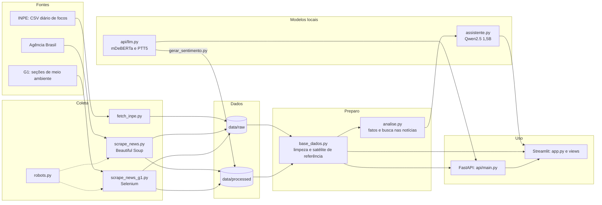
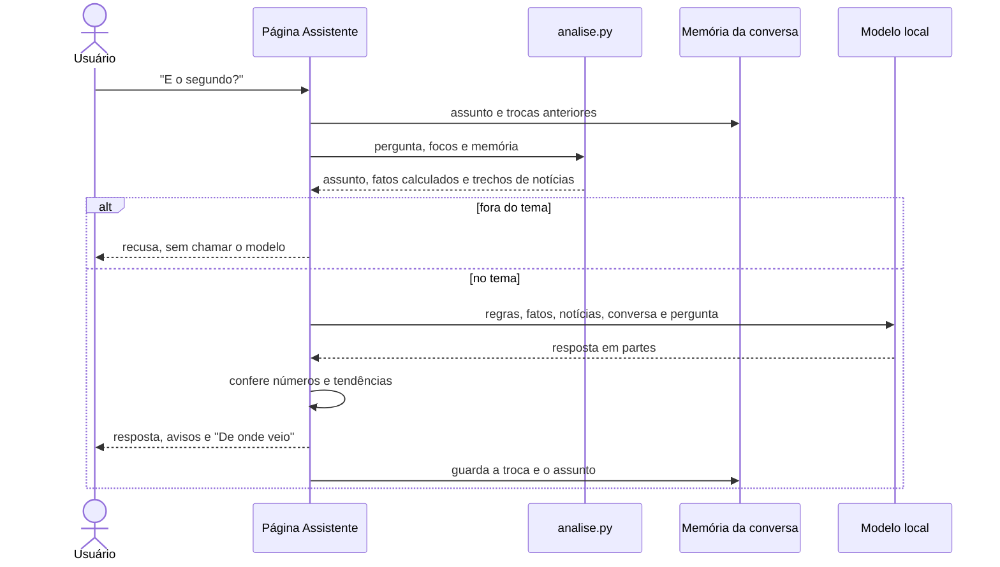

# Arquitetura da solução: Monitor de Queimadas

Artefato do TDSP sob responsabilidade do Solution Architect.

## Caminho de uma pergunta no Assistente

## Decisões

| Decisão | Motivo |
|---------|--------|
| Coleta em scripts separados do app | Uma mudança em um site não derruba a aplicação, e os dados versionados servem de reserva |
| Assistente dentro do Streamlit, e não na API | A conversa é da sessão do usuário, e basta um comando para usar. A API continua para acesso programático |
| Modelos locais | Sem custo por uso e sem enviar dados a terceiros |
| Contas fora do modelo | Modelo pequeno erra conta; pandas não |
| Satélite de referência por padrão | É o critério do INPE para comparar lugares e datas |
| `GET /focos` devolve todos os satélites | Quem usa a API recebe a base completa, com a coluna `satelite` para filtrar |
